# Carewell — Clinic Management

Aplikasi manajemen klinik full-stack untuk mengelola pasien, jadwal dokter, departemen,
rekam medis, dan billing — lengkap dengan dashboard analitik, hak akses tiga peran
(admin / dokter / resepsionis), dan jejak aktivitas pengguna.

**Frontend** Vue 3 + Vite + Tailwind CSS v4 · **Backend** Node.js + Express 5 + MySQL 8


Seluruh data (pasien, dokter, departemen, appointment, rekam medis, invoice) disimpan di MySQL
dan diakses melalui REST API JSON. Tidak ada data dummy di sisi Vue — semua angka di dashboard,
laporan, dan ringkasan dihitung dari database.

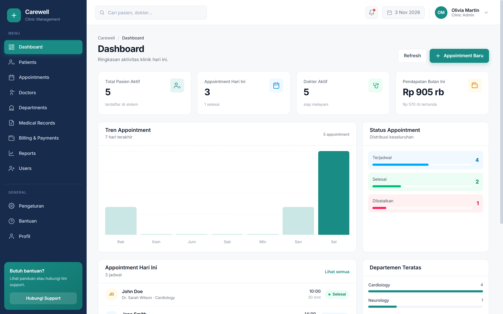

## Daftar Isi

- [Fitur Utama](#fitur-utama)
- [Tech Stack](#tech-stack)
- [Arsitektur](#arsitektur)
- [Tampilan Aplikasi](#tampilan-aplikasi)
- [1. Cara Menjalankan](#1-cara-menjalankan)
- [2. Struktur Folder](#2-struktur-folder)
- [3. Database](#3-database)
- [4. Daftar Endpoint](#4-daftar-endpoint)
- [5. Detail Fitur Frontend](#5-detail-fitur-frontend)
- [6. Cara Menguji](#6-cara-menguji)
- [7. Catatan Keamanan](#7-catatan-keamanan)
- [8. Perintah npm](#8-perintah-npm)
- [Limitasi & Rencana Pengembangan](#limitasi--rencana-pengembangan)

---

## Fitur Utama

- **Autentikasi & sesi** — login JWT (`jsonwebtoken`), password di-hash `bcryptjs`, sesi
  dipulihkan saat halaman dimuat ulang, token kedaluwarsa memicu logout otomatis.
- **Hak akses tiga peran** — admin, dokter, dan resepsionis punya menu, data, dan aksi
  berbeda. Matriks izin ada di satu tempat dan dipakai backend maupun frontend.
- **Dashboard analitik** — kartu statistik, grafik tren appointment 7 hari, distribusi status
  appointment, daftar jadwal hari ini, dan departemen teratas; semuanya dihitung dari MySQL.
  Dokter melihat versi terbatas yang hanya berisi datanya sendiri.
- **Manajemen pasien** — CRUD penuh, kode otomatis (`P-XXXX`), hitung usia dari tanggal lahir,
  pencarian & filter status, pagination, dan export CSV.
- **Appointment** — CRUD, ubah status (selesai / batal / no-show), filter tanggal & status,
  ringkasan jumlah jadwal.
- **Dokter & departemen** — CRUD dengan relasi foreign key, okupansi bed, jumlah dokter/pasien
  per departemen.
- **Rekam medis** — CRUD, 6 tipe rekaman (lab, rontgen, ECG, tes darah, konsultasi, resep),
  relasi ke pasien / dokter / appointment.
- **Billing & payments** — CRUD invoice, kode otomatis (`INV-XXX`), tandai lunas, auto-flag
  jatuh tempo.
- **Laporan** — laporan pasien / keuangan / performa dokter, 5 periode, export CSV, dan cetak.
- **Manajemen user** — (admin) CRUD akun, tautkan akun dokter ↔ data dokter, reset password,
  dan **jejak aktivitas** seluruh perubahan data.
- **Profil saya** — ubah nama sendiri, ganti password dengan verifikasi password lama, dan
  lihat daftar modul yang diizinkan.
- **UX lengkap** — loading state, empty state, toast notification, modal konfirmasi, dan layout
  responsif (desktop & mobile).

## Tech Stack

| Layer           | Teknologi                                                              |
| --------------- | ---------------------------------------------------------------------- |
| Frontend        | Vue 3 (Composition API), Vite 8, Tailwind CSS v4, Vue Router           |
| Backend         | Node.js + Express 5 (ESM), tanpa ORM                                   |
| Database        | MySQL 8 (InnoDB, utf8mb4) via `mysql2/promise`                          |
| Autentikasi     | JWT (`jsonwebtoken`) + `bcryptjs`                                      |
| Export          | CSV dibuat di sisi klien (Blob), cetak lewat `window.print()`          |
| Dev environment | Laragon (Apache + MySQL 8.0.30) + Adminer sebagai UI database          |

## Arsitektur

```
Browser (Vue 3 SPA)
        │  fetch JSON  /api/*
        ▼
Express 5 (server/index.js, port 3000)
        │  guard = authenticate → auditTrail → requireDoctorLink → requireModule
        │  mysql2 prepared statements
        ▼
MySQL 8  carewell_clinic
        ▲
        └── schema.sql (DDL) + seed.js (data contoh) + migrations/001..004
```

- Frontend memakai satu `fetch` wrapper (`src/lib/api.js`) dengan kelas `ApiError` dan
  penanganan sesi kedaluwarsa terpusat.
- Backend memusatkan auth (`server/auth.js`), izin (`server/permissions.js`), pembatasan data
  dokter (`server/scope.js`), dan pencatatan aktivitas (`server/audit.js`).
- Setiap prefix route dipasangi `guard(modul)` sehingga endpoint baru otomatis ikut aturan izin.
- Frontend dan backend berjalan terpisah saat development (5173 dan 3000), dihubungkan CORS.

## Tampilan Aplikasi

| Dashboard | Data Pasien |
| --- | --- |
|  | 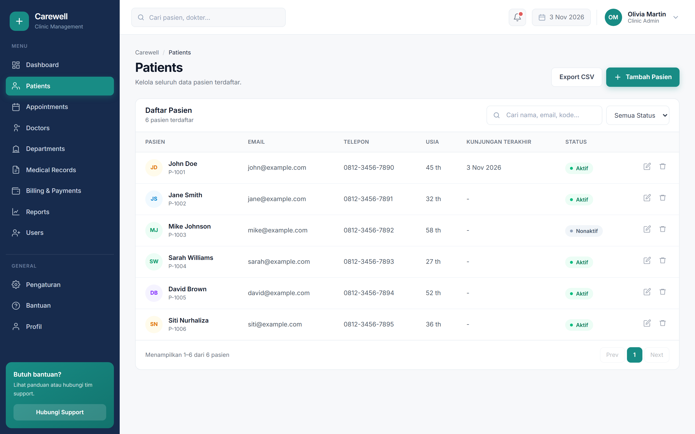 |

| Appointment | Data Dokter |
| --- | --- |
| 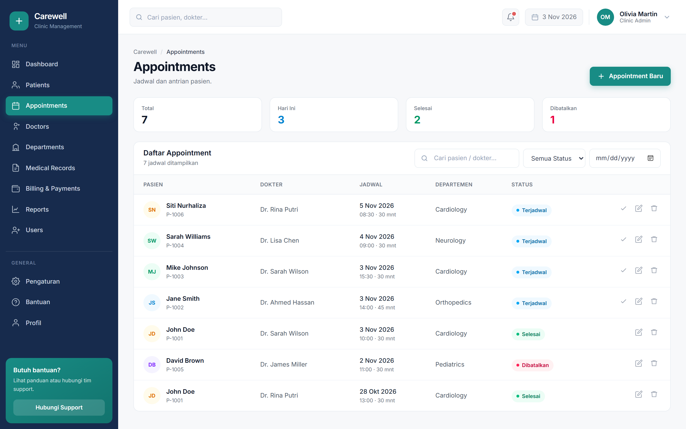 | 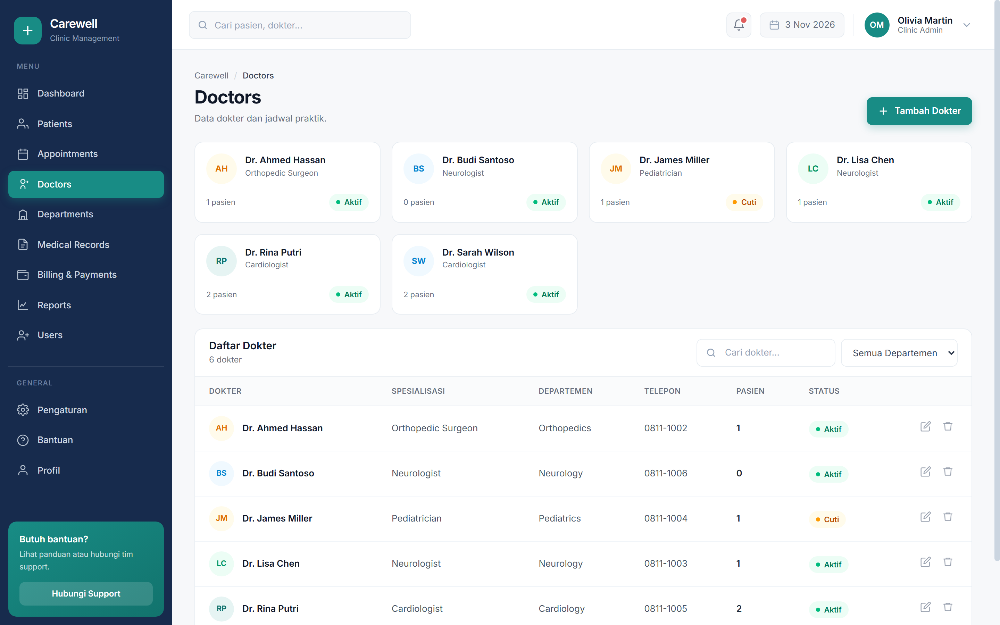 |

| Departemen | Rekam Medis |
| --- | --- |
| 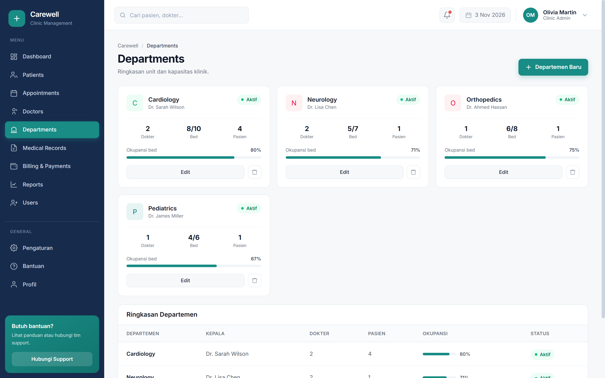 | 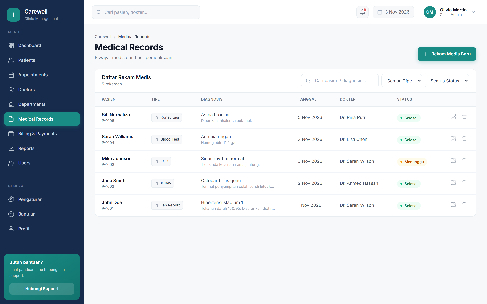 |

| Billing & Payments | Laporan |
| --- | --- |
| 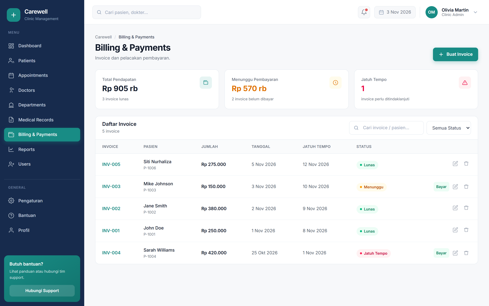 | 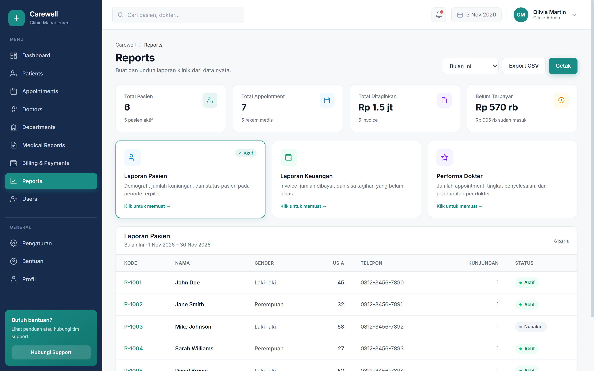 |

| Users — Akun & Hak Akses | Users — Jejak Aktivitas |
| --- | --- |
| 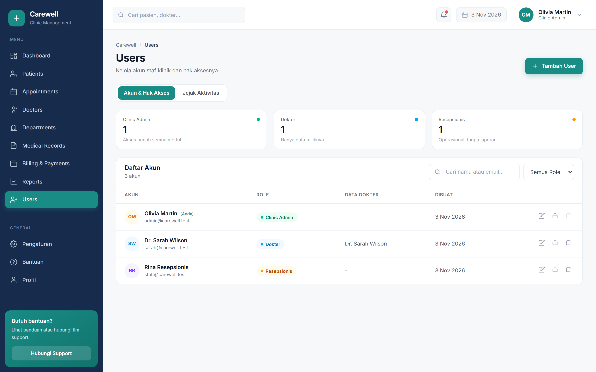 | 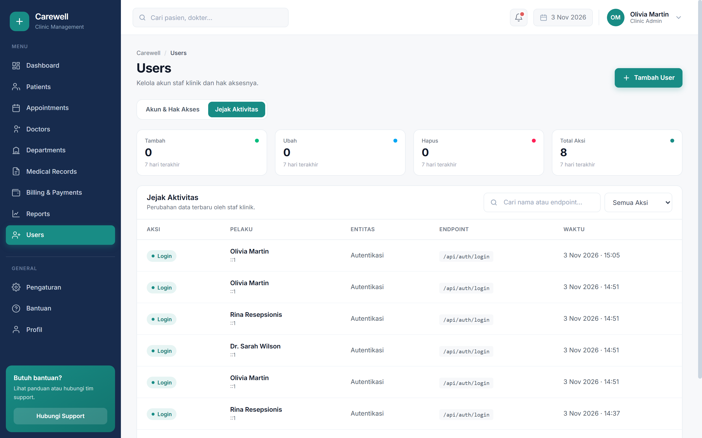 |

| Modal Tambah User | Profil Saya |
| --- | --- |
| 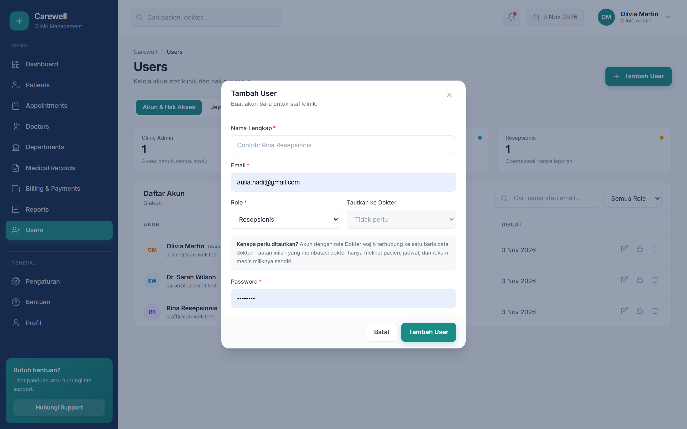 | 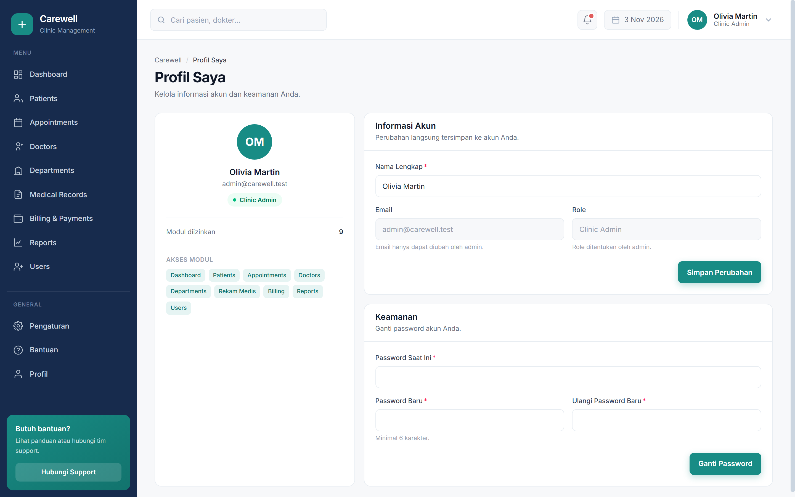 |

| Halaman Login | Halaman Terlarang |
| --- | --- |
| 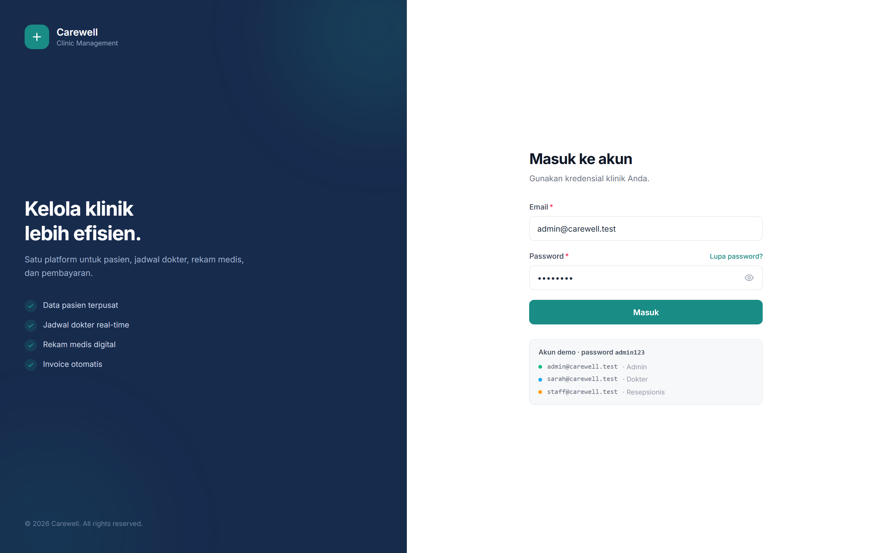 | 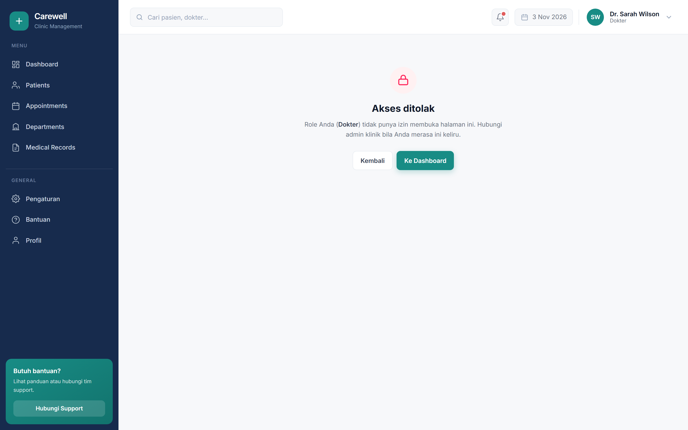 |

Dashboard dokter hanya menampilkan data miliknya sendiri:

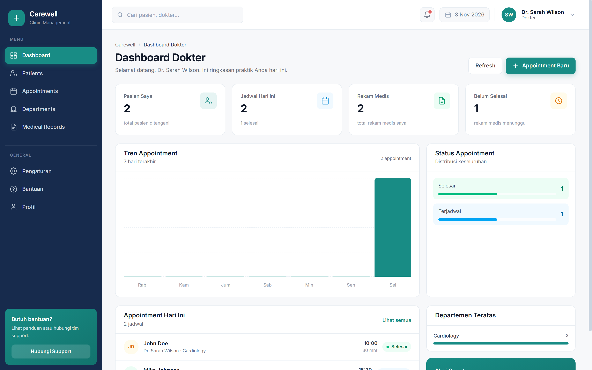

<p align="center">
  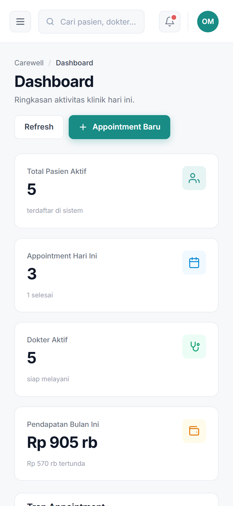
  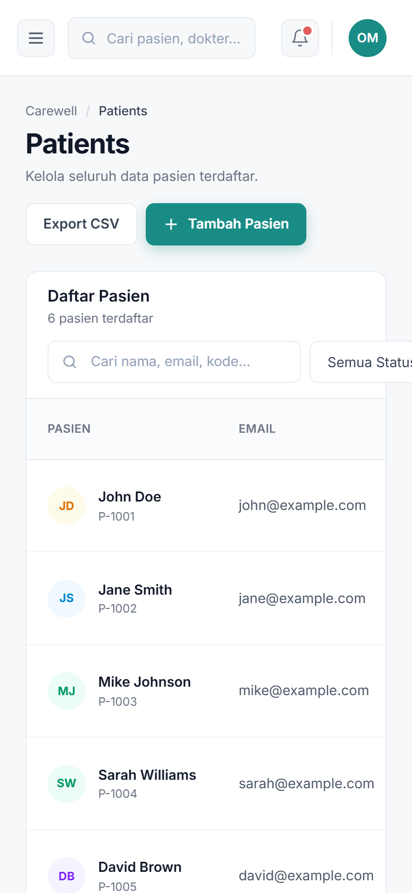
  <br>
  <sub>Tampilan responsif di layar mobile (390 × 844)</sub>
</p>

---

## 1. Cara Menjalankan

Prasyarat: **Node.js 20.19+ atau 22.12+** (syarat Vite 8), **MySQL 8** berjalan di
`127.0.0.1:3306` (mis. lewat Laragon).

### 1.1 Install dependensi

```bash
npm install
```

### 1.2 Buat database & tabel

```bash
# Windows (Laragon) — mysql.exe tidak ada di PATH, pakai path lengkap
& "D:\Program\Laragon\bin\mysql\mysql-8.0.30-winx64\bin\mysql.exe" -u root < server\schema.sql

# atau bila mysql sudah ada di PATH
mysql -u root < server/schema.sql
```

### 1.3 Buat user database khusus

Disarankan **tidak memakai `root` tanpa password**. Buat user yang hanya punya akses ke
database ini:

```sql
CREATE USER 'carewell'@'localhost' IDENTIFIED BY 'carewell123';
CREATE USER 'carewell'@'127.0.0.1' IDENTIFIED BY 'carewell123';
GRANT ALL PRIVILEGES ON carewell_clinic.* TO 'carewell'@'localhost';
GRANT ALL PRIVILEGES ON carewell_clinic.* TO 'carewell'@'127.0.0.1';
FLUSH PRIVILEGES;
```

> **Kenapa perlu?** Adminer menolak login dengan password kosong
> ("Adminer does not support accessing a database without a password"), sehingga UI database
> tidak bisa dipakai lewat `root` tanpa password. User berpassword juga membuat aplikasi tidak
> berjalan sebagai `root`, sehingga tidak bisa menyentuh database lain di mesin yang sama.
>
> Ganti `carewell123` dengan password yang lebih kuat untuk pemakaian nyata.

### 1.4 Konfigurasi `.env`

```bash
# Windows
Copy-Item .env.example .env

# atau macOS/Linux
cp .env.example .env
```

Isi `.env`:

```env
DB_HOST=127.0.0.1
DB_PORT=3306
DB_USER=carewell
DB_PASSWORD=carewell123
DB_NAME=carewell_clinic

PORT=3000

JWT_SECRET=ganti-dengan-secret-acak-yang-kuat
JWT_EXPIRES_IN=7d
```

> `.env` sudah masuk `.gitignore` — jangan pernah commit kredensial. Ganti `JWT_SECRET` dengan
> nilai acak: `node -e "console.log(require('crypto').randomBytes(48).toString('hex'))"`

### 1.5 Isi data contoh

```bash
npm run seed
```

Seed membuat 3 akun, 6 dokter, 4 departemen, 6 pasien, 7 appointment, 5 rekam medis, dan
5 invoice. Perintah ini **mengosongkan** tabel terlebih dahulu (`TRUNCATE`).

### 1.6 Jalankan aplikasi

Butuh **dua terminal**:

```bash
# Terminal 1 — backend API (port 3000)
npm run server

# Terminal 2 — frontend (port 5173)
npm run dev
```

Buka **http://localhost:5173**.

### 1.7 Akun demo

Semua password: `admin123`

| Email                  | Password   | Role          | Label di UI  | Cakupan                          |
| ---------------------- | ---------- | ------------- | ------------ | -------------------------------- |
| `admin@carewell.test`  | `admin123` | `admin`       | Clinic Admin | Semua modul, semua data          |
| `sarah@carewell.test`  | `admin123` | `doctor`      | Dokter       | Hanya pasien & jadwal miliknya   |
| `staff@carewell.test`  | `admin123` | `staff`       | Resepsionis  | Operasional, tanpa laporan       |

Halaman login menampilkan daftar tiga akun demo beserta label role-nya, dan tombol
**"Lupa password?"** membuka panduan (bukan reset mandiri — reset dilakukan admin lewat menu
Users). Password disimpan sebagai hash bcrypt.

---

## 2. Struktur Folder

```
clinic-management/
├── src/                          # frontend Vue 3 (Vite root)
│   ├── main.js                   # bootstrap: tunggu router siap → pulihkan sesi → mount
│   ├── App.vue                   # layout publik (login) vs protected (sidebar + header)
│   ├── style.css                 # Tailwind v4: @import "tailwindcss" + @theme {}
│   ├── router/index.js           # definisi route + guard izin per modul
│   ├── lib/
│   │   ├── api.js                # fetch wrapper (ApiError, token, sesi kedaluwarsa)
│   │   ├── auth.js               # state user, permissions, login/logout
│   │   ├── format.js             # format tanggal, IDR, usia, inisial
│   │   ├── toast.js              # notifikasi toast global
│   │   └── ui.js                 # helper kelas tombol/badge bersama
│   └── components/
│       ├── Sidebar.vue           # menu #172B4D, difilter dari user.permissions
│       ├── Header.vue
│       ├── Dashboard.vue
│       ├── pages/                # Login, Patients, Appointments, Doctors, Departments,
│       │                         # MedicalRecords, Billing, Reports, Users, Profile, Forbidden
│       └── ui/                   # Badge, Card, BaseButton, StatCard, AppModal,
│                                 # TextField, TextareaField, SelectField, ConfirmDialog,
│                                 # EmptyState, LoadingState, PageHeader, SearchInput,
│                                 # ToastHost
├── server/                       # backend Express 5
│   ├── index.js                  # entry; guard = authenticate → auditTrail →
│   │                             # requireDoctorLink → requireModule(modul)
│   ├── db.js                     # pool mysql2 + helper query() / one()
│   ├── auth.js                   # middleware authenticate, signToken, publicUser
│   ├── permissions.js            # PERMISSIONS, can(), authorize(), requireModule(),
│   │                             # isScopedDoctor(), requireDoctorLink(), doctorScopeId()
│   ├── scope.js                  # penjagaan data milik dokter (doctorHasPatient, dll.)
│   ├── audit.js                  # auditTrail middleware + writeAudit()
│   ├── rate-limit.js             # throttle login in-memory (8 gagal / 15 menit)
│   ├── helpers.js                # asyncHandler, validasi require_(), paging
│   ├── schema.sql                # DDL 8 tabel (FK + index)
│   ├── seed.js                   # data contoh
│   ├── migrations/               # 001..004
│   └── routes/                   # auth, dashboard, patients, appointments, doctors,
│                                 # departments, records, invoices, reports, users, audit
├── docs/screenshots/             # tangkapan layar untuk dokumentasi
├── .env.example
├── vite.config.js                # plugin vue + @tailwindcss/vite
└── package.json
```

---

## 3. Database

Nama database: **`carewell_clinic`** · engine **InnoDB** · charset **utf8mb4**.

### Tabel & relasi

| Tabel             | Kolom penting                                                                                      |
| ----------------- | -------------------------------------------------------------------------------------------------- |
| `users`           | `id` PK, `email` UNIQUE, `password_hash`, `role` ENUM(`admin`,`doctor`,`staff`), `doctor_id` FK→`doctors.id` |
| `departments`     | `id` PK, `name` UNIQUE, `head_doctor`, `total_beds`, `used_beds`, `is_active`                        |
| `doctors`         | `id` PK, `department_id` FK→`departments.id`, `name`, `specialization`, `status` ENUM(`active`,`on_leave`,`inactive`) |
| `patients`        | `id` PK, `code` UNIQUE (`P-XXXX`), `name`, `gender`, `birth_date`, `blood_type`, `status`            |
| `appointments`    | `id` PK, `patient_id` FK, `doctor_id` FK, `department_id` FK, `scheduled_at`, `status` ENUM          |
| `medical_records` | `id` PK, `patient_id` FK, `doctor_id` FK, `appointment_id` FK, `record_type` ENUM, `record_date`     |
| `invoices`        | `id` PK, `code` UNIQUE (`INV-XXX`), `patient_id` FK, `appointment_id` FK, `amount`, `paid_amount`, `status` ENUM |
| `audit_log`       | `id` PK, `user_id` FK→`users.id`, `user_name`, `action`, `entity`, `entity_id`, `path`, `ip`, `created_at` |

Perilaku foreign key:

- `doctors.department_id`, `medical_records.doctor_id`, `medical_records.appointment_id`,
  `invoices.appointment_id`, `audit_log.user_id` → **ON DELETE SET NULL**
- `appointments.patient_id`, `appointments.doctor_id`, `medical_records.patient_id`,
  `invoices.patient_id` → **ON DELETE CASCADE**

Index tambahan untuk kolom yang sering difilter: `doctors.department_id`, `doctors.status`,
`patients.name`, `patients.status`, `appointments.scheduled_at`, `appointments.status`,
`medical_records.record_date`, `medical_records.status`, `invoices.status`, `invoices.issue_date`,
`audit_log.created_at`, `audit_log.user_id`, `audit_log.entity`.

### Relasi akun ↔ dokter

`users.doctor_id` menautkan akun login ke baris `doctors`. Unique index `uq_user_doctor`
menjaga relasi **1:1** — satu dokter hanya boleh punya satu akun. Tautan ini yang dipakai
untuk membatasi data dokter ke pasien dan jadwal miliknya.

### Migrasi

Jika database sudah dibuat sebelum fitur role ditambahkan, jalankan migrasi berikut **berurutan**:

```bash
& "D:\Program\Laragon\bin\mysql\mysql-8.0.30-winx64\bin\mysql.exe" -u root < server\migrations\001_user_doctor_link.sql
& "D:\Program\Laragon\bin\mysql\mysql-8.0.30-winx64\bin\mysql.exe" -u root < server\migrations\002_staff_user.sql
& "D:\Program\Laragon\bin\mysql\mysql-8.0.30-winx64\bin\mysql.exe" -u root < server\migrations\003_user_doctor_unique.sql
& "D:\Program\Laragon\bin\mysql\mysql-8.0.30-winx64\bin\mysql.exe" -u root < server\migrations\004_audit_log.sql
```

| Migrasi                        | Isi                                                                     |
| ------------------------------ | ----------------------------------------------------------------------- |
| `001_user_doctor_link.sql`     | Kolom `users.doctor_id` + FK ke `doctors`, lalu menautkan akun Dr. Sarah  |
| `002_staff_user.sql`           | Akun demo resepsionis                                                   |
| `003_user_doctor_unique.sql`   | Unique index `uq_user_doctor` — satu dokter hanya boleh punya satu akun  |
| `004_audit_log.sql`            | Tabel `audit_log` untuk jejak perubahan data                            |

Semua migrasi idempoten (aman dijalankan berulang).

### Akses database

**Adminer** — UI berbasis browser, sudah termasuk di Laragon. Buka:

```
http://localhost/adminer
```

| Kolom    | Isi                |
| -------- | ------------------ |
| System   | `MySQL`            |
| Server   | `127.0.0.1`        |
| Username | `carewell`         |
| Password | `carewell123`      |
| Database | `carewell_clinic`  |

**Terminal:**

```powershell
$mysql = "D:\Program\Laragon\bin\mysql\mysql-8.0.30-winx64\bin\mysql.exe"
& $mysql -u carewell -p carewell_clinic
```

Contoh query langsung:

```powershell
& $mysql -u carewell -pcarewell123 -h 127.0.0.1 -e "USE carewell_clinic; SELECT * FROM patients;"
& $mysql -u carewell -pcarewell123 -h 127.0.0.1 -e "USE carewell_clinic; SHOW TABLES;"
```

> **Catatan:** `mysql.exe` di Laragon tidak otomatis ada di PATH. Tambahkan folder
> `D:\Program\Laragon\bin\mysql\mysql-8.0.30-winx64\bin` ke PATH bila ingin memanggil `mysql`
> langsung. Ingat: MySQL adalah *server* database — ia tidak punya UI sendiri; Adminer atau
> phpMyAdmin adalah aplikasi terpisah yang dipakai untuk mengelolanya.

### Reset database

```powershell
# bangun ulang seluruh skema (HAPUS semua data)
& "D:\Program\Laragon\bin\mysql\mysql-8.0.30-winx64\bin\mysql.exe" -u root < server\schema.sql

# isi data contoh
npm run seed
```

---

## 4. Daftar Endpoint

Semua endpoint berada di bawah `/api` dan mengembalikan JSON. Error memakai bentuk
`{ "error": "pesan" }`. Semua endpoint **wajib** header `Authorization: Bearer <token>`,
kecuali `POST /api/auth/login` dan `GET /api/health`.

Status yang dipakai: `200` sukses, `201` dibuat, `400` body tidak valid, `401` belum
terautentikasi / token kedaluwarsa, `403` izin ditolak, `404` tidak ditemukan, `422` validasi
field gagal, `429` terlalu banyak percobaan login, `500` error server (pesan DB tidak dibocorkan).

### Autentikasi

| Method | Endpoint               | Keterangan                                        |
| ------ | ---------------------- | ------------------------------------------------- |
| GET    | `/api/health`          | status server + koneksi DB                        |
| POST   | `/api/auth/login`      | `{ email, password }` → `token` + `user` + `permissions` |
| GET    | `/api/auth/me`         | profil user aktif                                 |
| PATCH  | `/api/auth/profile`    | ubah nama sendiri                                 |
| PATCH  | `/api/auth/password`   | ganti password sendiri (verifikasi password lama) |

### Dashboard

| Method | Endpoint          | Keterangan                                                                 |
| ------ | ----------------- | -------------------------------------------------------------------------- |
| GET    | `/api/dashboard`  | total pasien/dokter/appointment, tren 7 hari, distribusi status, jadwal hari ini, departemen teratas — semua dihitung dari MySQL. Untuk dokter, angkanya otomatis dibatasi ke data miliknya |

### Pasien

| Method | Endpoint              | Keterangan                                                        |
| ------ | --------------------- | ----------------------------------------------------------------- |
| GET    | `/api/patients`       | filter `search`, `status`; dokter hanya melihat pasiennya sendiri  |
| GET    | `/api/patients/:id`   | detail + usia; dokter ditolak 403 bila bukan pasiennya             |
| POST   | `/api/patients`       | tambah (admin, staff) — kode `P-XXXX` dibuat otomatis              |
| PUT    | `/api/patients/:id`   | ubah (admin, staff)                                               |
| DELETE | `/api/patients/:id`   | hapus (admin) — cascade ke appointment, rekam medis, invoice       |

### Appointment

| Method | Endpoint                          | Keterangan                                     |
| ------ | --------------------------------- | ---------------------------------------------- |
| GET    | `/api/appointments`               | filter `date`, `status`, `doctor_id`, `patient_id`; dokter hanya miliknya |
| GET    | `/api/appointments/:id`           | detail                                         |
| POST   | `/api/appointments`               | tambah                                         |
| PUT    | `/api/appointments/:id`           | ubah                                           |
| PATCH  | `/api/appointments/:id/status`    | ubah status saja (`scheduled`/`completed`/`cancelled`/`no_show`) |
| DELETE | `/api/appointments/:id`           | hapus (dokter hanya miliknya)                  |

### Dokter

| Method | Endpoint             | Keterangan                          |
| ------ | -------------------- | ----------------------------------- |
| GET    | `/api/doctors`       | list + jumlah pasien                |
| GET    | `/api/doctors/:id`   | detail                              |
| POST   | `/api/doctors`       | tambah (admin)                      |
| PUT    | `/api/doctors/:id`   | ubah (admin)                        |
| DELETE | `/api/doctors/:id`   | hapus (admin)                       |

### Departemen

| Method | Endpoint                  | Keterangan                          |
| ------ | ------------------------- | ----------------------------------- |
| GET    | `/api/departments`        | list + okupansi bed, jumlah dokter  |
| GET    | `/api/departments/:id`    | detail                              |
| POST   | `/api/departments`        | tambah (admin)                      |
| PUT    | `/api/departments/:id`    | ubah (admin)                        |
| DELETE | `/api/departments/:id`    | hapus (admin)                       |

### Rekam medis

| Method | Endpoint             | Keterangan                                                  |
| ------ | -------------------- | ----------------------------------------------------------- |
| GET    | `/api/records`       | filter `type`, `patient_id`, `status`; dokter hanya miliknya |
| GET    | `/api/records/:id`   | detail                                                      |
| POST   | `/api/records`       | tambah (admin, staff)                                       |
| PUT    | `/api/records/:id`   | ubah                                                        |
| DELETE | `/api/records/:id`   | hapus (admin)                                               |

### Billing

| Method | Endpoint                   | Keterangan                                    |
| ------ | -------------------------- | --------------------------------------------- |
| GET    | `/api/invoices`            | filter `status`, `search`                     |
| GET    | `/api/invoices/:id`        | detail                                        |
| POST   | `/api/invoices`            | tambah (admin, staff) — kode `INV-XXX` otomatis |
| PUT    | `/api/invoices/:id`        | ubah                                          |
| PATCH  | `/api/invoices/:id/pay`    | tandai lunas                                  |
| DELETE | `/api/invoices/:id`        | hapus (admin)                                 |

### Laporan

| Method | Endpoint                        | Keterangan                                                       |
| ------ | ------------------------------- | ---------------------------------------------------------------- |
| GET    | `/api/reports/overview`         | ringkasan untuk kartu laporan                                    |
| GET    | `/api/reports?type=&period=`    | `type`: `patients`/`finance`/`doctors`; `period`: `this_month`/`last_month`/`last_7`/`year`/`all` |

### Users & jejak aktivitas

| Method | Endpoint                      | Keterangan                                                     |
| ------ | ----------------------------- | -------------------------------------------------------------- |
| GET    | `/api/users`                  | (admin) list akun, filter `search`, `role`                     |
| GET    | `/api/users/:id`              | (admin) detail                                                 |
| POST   | `/api/users`                  | (admin) buat akun — role `doctor` wajib `doctor_id`            |
| PUT    | `/api/users/:id`              | (admin) ubah akun                                              |
| PATCH  | `/api/users/:id/password`     | (admin) reset password akun lain                               |
| DELETE | `/api/users/:id`              | (admin) hapus akun                                             |
| GET    | `/api/audit`                  | (admin) jejak perubahan, filter `limit`, `action`, `entity`, `user_id`, `search` |
| GET    | `/api/audit/summary`          | (admin) ringkasan jumlah aksi 7 hari terakhir                  |

### Hak akses per role

Matriks izin ada di satu tempat: `server/permissions.js`. Backend memasang `requireModule(...)`
per prefix route, frontend memfilter menu dari `user.permissions` yang dikirim saat login.

| Modul               | Admin       | Dokter                | Resepsionis     |
| ------------------- | :---------: | :-------------------: | :-------------: |
| Dashboard           | ✅ penuh    | ✅ versi dirinya      | ✅ penuh        |
| Patients            | ✅ CRUD     | 👁 hanya pasiennya    | ✅ tambah/ubah  |
| Appointments        | ✅ CRUD     | ✅ miliknya saja      | ✅ CRUD         |
| Doctors             | ✅ CRUD     | ❌                    | 👁 hanya lihat  |
| Departments         | ✅ CRUD     | 👁 hanya lihat        | 👁 hanya lihat  |
| Medical Records     | ✅ CRUD     | ✅ miliknya saja      | ✅ tambah/ubah  |
| Billing & Payments  | ✅ CRUD     | ❌                    | ✅ tambah/ubah  |
| Reports             | ✅          | ❌                    | ❌              |
| Users               | ✅ CRUD     | ❌                    | ❌              |

---

## 5. Detail Fitur Frontend

- **Login** — validasi form, tampilkan/sembunyikan password, panel bantuan "Lupa password?",
  daftar akun demo, dan pesan error yang jelas untuk 401 maupun 429.
- **Layout** — sidebar `#172B4D` dengan aksen `#188C85`, menu difilter sesuai `user.permissions`,
  header berisi pencarian, notifikasi, dan menu profil. Di mobile sidebar berubah jadi drawer.
- **Dashboard** — kartu statistik, grafik tren appointment 7 hari, distribusi status, jadwal
  hari ini, departemen teratas, dan panel aksi cepat. Dokter mendapat versi terbatas (tanpa
  angka global).
- **Pasien** — tabel dengan pencarian, filter status, pagination, modal tambah/edit,
  konfirmasi hapus, dan export CSV.
- **Appointment** — daftar dengan filter tanggal & status, ubah status cepat, ringkasan jadwal.
- **Dokter & Departemen** — CRUD dengan select relasi departemen, badge status, okupansi bed.
- **Rekam medis** — CRUD dengan select pasien/dokter/appointment dan 6 tipe rekaman.
- **Billing** — CRUD invoice, tandai lunas, badge status (lunas / pending / jatuh tempo),
  ringkasan total.
- **Laporan** — tab pasien / keuangan / performa dokter, pemilih periode, export CSV, cetak.
- **Users** — dua tab: **Akun & Hak Akses** (CRUD akun, tautkan dokter, ganti password) dan
  **Jejak Aktivitas** (kartu ringkasan 7 hari + tabel audit dengan filter aksi dan pencarian).
- **Profil Saya** — ubah nama, ganti password dengan verifikasi password lama, dan chip daftar
  modul yang diizinkan.
- **Halaman terlarang** — `/forbidden` dengan tombol kembali ke dashboard; muncul saat role
  membuka URL modul yang tidak diizinkan.
- Semua halaman punya loading state, empty state, toast, dan modal konfirmasi hapus. Setiap
  mutasi memuat ulang data terkait.

---

## 6. Cara Menguji

### Uji manual di browser

1. Buka `http://localhost:5173`.
2. Login sebagai `admin@carewell.test` — sidebar menampilkan **9 menu**.
3. Cek dashboard terisi angka & grafik dari database.
4. Tambah pasien → cari lewat kolom pencarian → edit → hapus (konfirmasi).
5. Tambah appointment, ubah statusnya, lalu buat rekam medis dan invoice untuk pasien itu.
6. Buka **Users** → buat akun baru → ganti password-nya → buka tab **Jejak Aktivitas** dan
   pastikan aksi tadi tercatat.
7. Logout, login sebagai `staff@carewell.test` — menu **Reports** dan **Users** hilang.
8. Logout, login sebagai `sarah@carewell.test` — hanya **5 menu**, dan tabel pasien hanya berisi
   pasien yang pernah ia tangani.
9. Ketik `http://localhost:5173/billing` saat login sebagai dokter → diarahkan ke `/forbidden`.
10. Refresh halaman: sesi tetap aktif dan data tetap ada.

### Uji API dengan PowerShell

```powershell
# tanpa token -> 401
curl.exe -i "http://localhost:3000/api/patients"

# login -> simpan token
$body = @{ email = 'admin@carewell.test'; password = 'admin123' } | ConvertTo-Json
$res  = Invoke-RestMethod -Method Post -Uri "http://localhost:3000/api/auth/login" `
          -ContentType 'application/json' -Body $body
$h = @{ Authorization = "Bearer $($res.token)" }

# data dengan token -> 200
Invoke-RestMethod -Uri "http://localhost:3000/api/patients" -Headers $h
Invoke-RestMethod -Uri "http://localhost:3000/api/dashboard" -Headers $h

# role yang tidak berhak -> 403
$s = Invoke-RestMethod -Method Post -Uri "http://localhost:3000/api/auth/login" `
       -ContentType 'application/json' `
       -Body (@{ email = 'sarah@carewell.test'; password = 'admin123' } | ConvertTo-Json)
Invoke-RestMethod -Uri "http://localhost:3000/api/users" -Headers @{ Authorization = "Bearer $($s.token)" }
```

### Uji keamanan yang bisa direproduksi

| Skenario                                              | Hasil yang diharapkan                     |
| ----------------------------------------------------- | ----------------------------------------- |
| Dokter membuka pasien yang bukan pasiennya (tebak ID) | `403` "Pasien ini bukan pasien Anda."     |
| Dokter memanggil `GET /api/users`                     | `403`                                     |
| Dokter memanggil `DELETE /api/patients/:id`           | `403` (hapus hanya admin)                 |
| Akun dokter tanpa `doctor_id` login                   | `403`, tidak ada token diterbitkan        |
| Admin menghapus akunnya sendiri                       | `422`                                     |
| Admin menurunkan role-nya sendiri                     | `422`                                     |
| Menautkan satu dokter ke dua akun                     | `422` "sudah tertaut ke akun ..."         |
| 8 kali login gagal dari IP + email yang sama          | percobaan ke-9 → `429` (reset 15 menit)   |
| Request yang ditolak 4xx                              | tidak muncul di `audit_log`               |

---

## 7. Catatan Keamanan

- Semua query memakai **prepared statement** `mysql2` (`?` placeholder) — tidak ada string SQL
  yang disisipi input pengguna.
- Password di-hash `bcryptjs` (10 salt rounds) dan tidak pernah dikirim ke klien; `password_hash`
  tidak pernah masuk response.
- Token JWT ditandatangani `JWT_SECRET` dengan masa berlaku `JWT_EXPIRES_IN`; token tidak valid
  atau kedaluwarsa memicu logout otomatis di frontend.
- **Izin ditegakkan dua lapis**: backend menolak dengan `403` lewat `requireModule()` /
  `authorize()`, frontend menyembunyikan menu & tombol yang tidak relevan. Menyembunyikan tombol
  saja tidak dianggap cukup — API tetap memvalidasi setiap request.
- **Prinsip fail-closed**: `isScopedDoctor()` hanya memeriksa `role === 'doctor'`, bukan
  keberadaan `doctor_id`. Akun dokter yang tautannya hilang ditolak `requireDoctorLink` sebelum
  menyentuh data, bukan malah membuka seluruh data.
- Dokter hanya bisa **membaca** pasien yang pernah ia tangani, dan hanya bisa mengubah
  appointment / rekam medis miliknya sendiri. Akses ke data pasien lain ditolak `403`, termasuk
  bila ID ditebak langsung. Membuat dan mengubah data pasien adalah hak admin & resepsionis.
- Admin tidak bisa menghapus akunnya sendiri, menurunkan role-nya sendiri, atau menghapus admin
  terakhir.
- Login dibatasi **8 percobaan gagal per 15 menit** per kombinasi IP + email (in-memory, tanpa
  dependensi tambahan). Setelah itu balasan `429` berisi sisa waktu tunggu dalam menit.
- **Audit trail** mencatat setiap POST/PUT/PATCH/DELETE yang berhasil (2xx) ke tabel `audit_log`:
  pelaku, aksi, entitas, id, endpoint, IP, dan waktu. Penolakan 4xx tidak dicatat karena bukan
  perubahan data. Penulisan log bersifat *best effort* — kegagalan log tidak menggagalkan aksi bisnis.
- Error database tidak dikirim mentah ke client — hanya pesan umum + HTTP status yang sesuai.
- `.env` masuk `.gitignore`; `.env.example` disediakan sebagai template tanpa kredensial nyata.
- User MySQL aplikasi (`carewell`) hanya punya grant pada `carewell_clinic`, sehingga tidak bisa
  menyentuh database lain di mesin yang sama.

---

## 8. Perintah npm

| Perintah         | Fungsi                                                    |
| ---------------- | --------------------------------------------------------- |
| `npm install`    | install dependensi frontend & backend                     |
| `npm run dev`    | Vite dev server (port 5173)                               |
| `npm run server` | backend Express (port 3000)                               |
| `npm run build`  | build produksi ke `dist/`                                 |
| `npm run preview`| pratinjau hasil build                                     |
| `npm run seed`   | isi ulang data contoh (mengosongkan tabel lebih dulu)      |

---

## Limitasi & Rencana Pengembangan

**Limitasi saat ini**

- Belum ada portal pasien — semua operasi dilakukan oleh staf klinik.
- Rate limiter login disimpan di memori proses, sehingga hitungannya hilang saat server
  di-restart dan tidak dibagi antar instance.
- Jejak aktivitas mencatat metadata perubahan, belum menyimpan nilai sebelum/sesudah (diff).
- Belum ada upload dokumen atau gambar medis; rekam medis hanya berisi teks.
- Belum ada notifikasi email/WhatsApp untuk pengingat jadwal.
- Belum ada demo online; aplikasi dijalankan lokal lewat Laragon.

**Rencana**

- Portal pasien: lihat jadwal, riwayat kunjungan, dan unduh invoice.
- Pindahkan rate limiter ke Redis agar konsisten antar instance.
- Simpan diff nilai pada `audit_log` + halaman pemulihan data.
- Upload lampiran hasil lab (PDF/gambar) pada rekam medis.
- Dockerfile + demo online, serta pipeline CI untuk build dan uji API.
